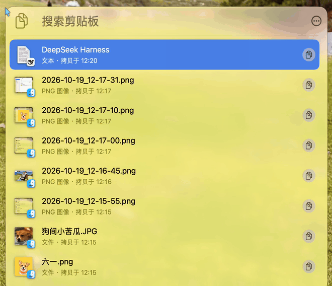
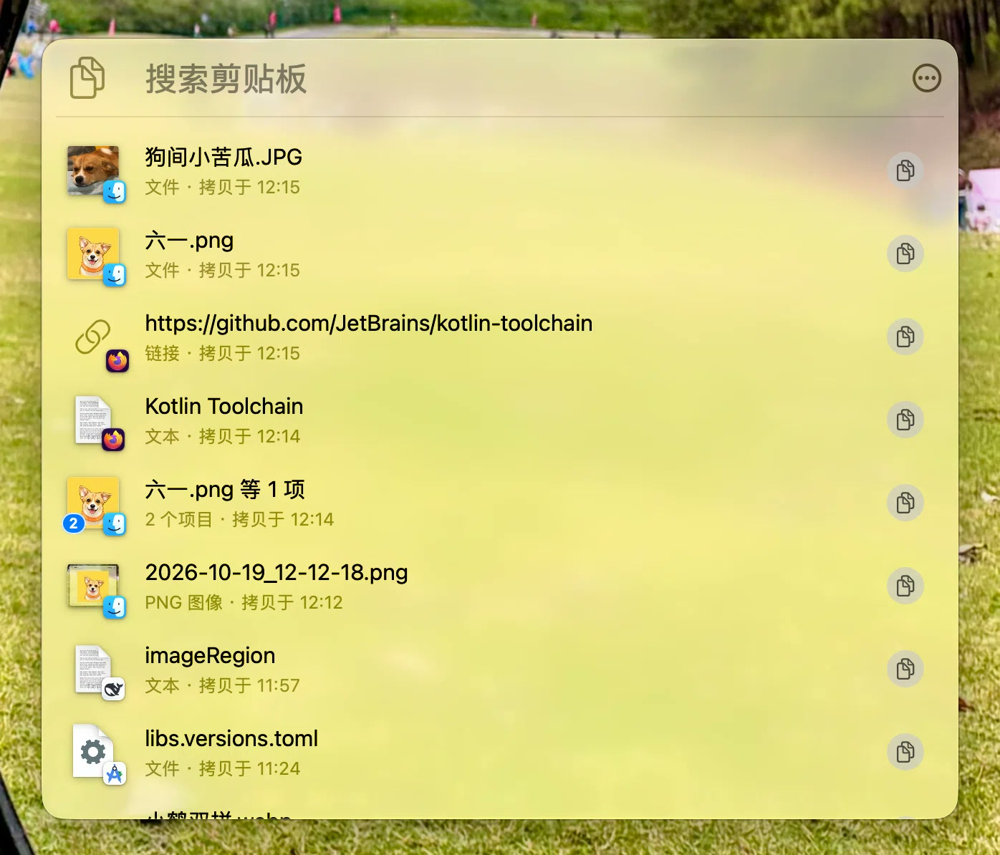
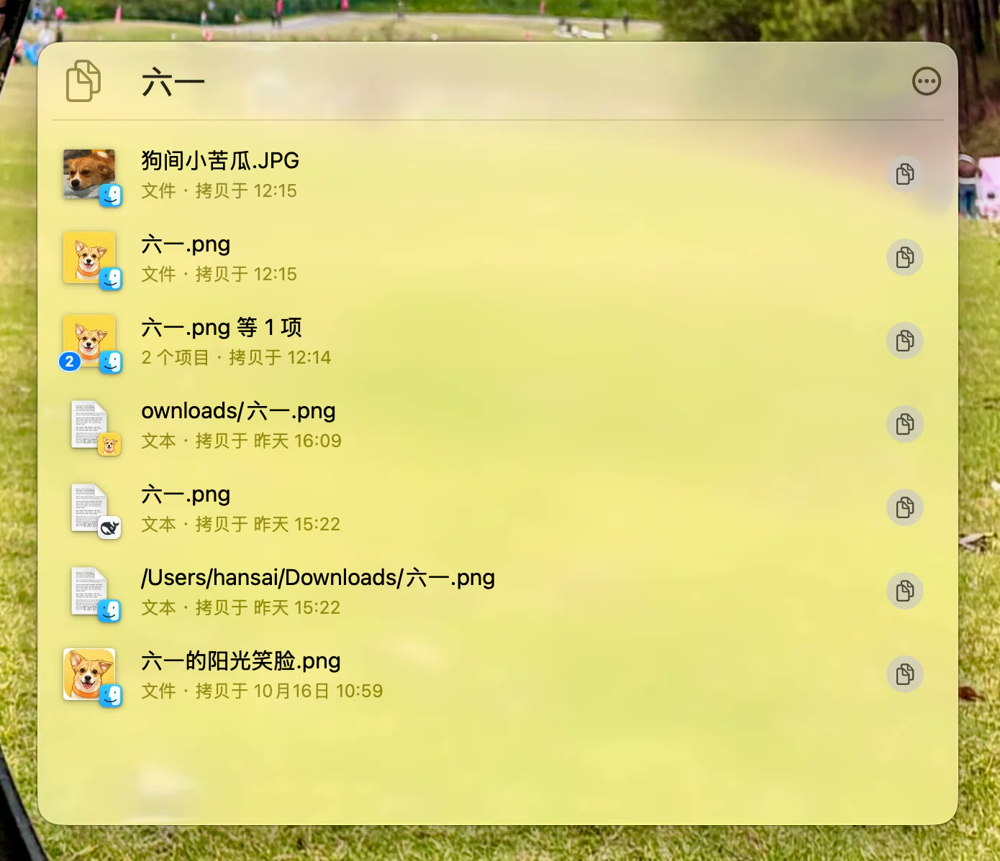
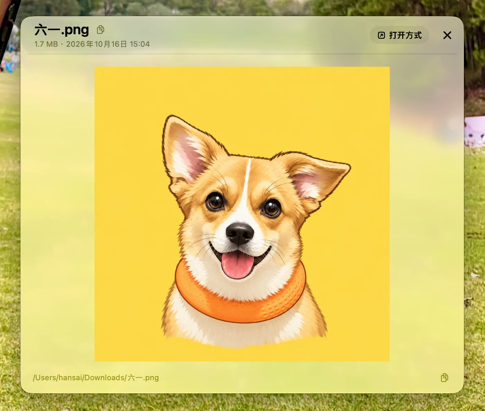
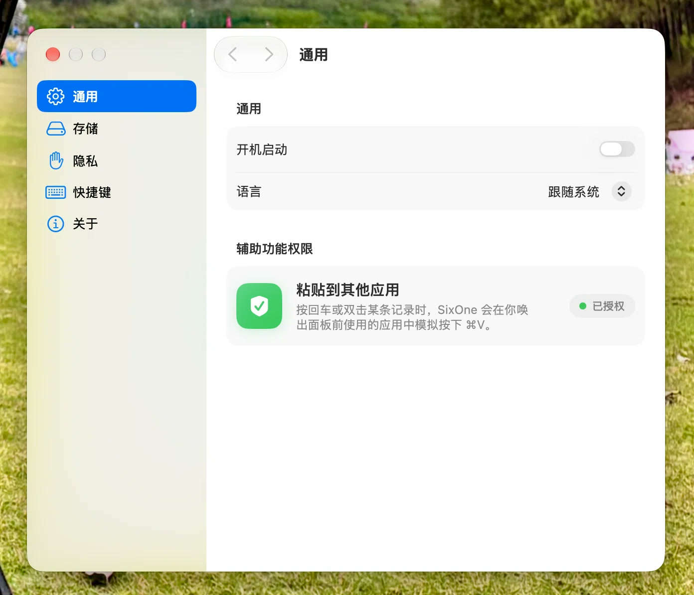

# SixOne

**English · [简体中文](README.md)**

A macOS menu-bar clipboard history tool. Press `⌃⌘V` (default) to open a floating panel; browse, search, preview, edit in place, and paste entries back. Five content kinds: **text / image / file (including multi-file groups) / link / colour**.

- Left-click the menu-bar icon to toggle the panel, right-click for a menu (Clipboard / Settings… / Quit). The panel anchors to the summon point: under the status item, under the pointer, or centred on screen.
- Native search field: filters body text, titles, and file paths, debounced 200 ms before querying the store.
- Previews: text (rich text, in-place editing, `⌘F` find), image (zoom / pan), file (image / video / web page / PDF / text / Quick Look), multi-file list (filter by name / path), link, colour. File and on-disk image previews show the source path at the bottom, draggable or copyable in one click.
- Item actions: copy back to the clipboard, paste into the previous app (synthesizes `⌘V`), share, open with the default app / reveal in Finder, delete, and plain-text copy / paste (`⇧⌘C` / `⇧⌘V`). If the previous app has quit or does not come forward, SixOne beeps and leaves the item on the clipboard rather than pasting into whatever is frontmost.
- Settings: ignored apps, retention, storage limit, global hotkey, language (Follow System / English / Chinese (Simplified)), launch at login, clear history. A language change takes effect after a restart.

## Screenshots

A short clip: open the panel, preview and zoom an image, copy its source path, then search the list:



| Panel | Search | Preview | Settings |
| --- | --- | --- | --- |
| <a href="docs/images/panel.jpg"></a> | <a href="docs/images/panel-search.jpg"></a> | <a href="docs/images/preview.jpg"></a> | <a href="docs/images/settings.jpg"></a> |

## Status

**1.0.0, source release.** No prebuilt binaries. The store is versioned (schema **V3**) and opened through `SixOneMigrationPlan`; upgrading from V1 migrates in place, so a schema change no longer requires clearing history. Migration is forward-only: back up the store before downgrading.

**Non-goals:** cloud sync, accounts, multi-device history, an iOS client, auto-update. SixOne is deliberately a local-only, single-Mac tool.

## Requirements

- **macOS 26.5 or later on Apple silicon.** Deployment target 26.5; the documented build command targets `arm64`.
- Verified with **Xcode 27.1 (27A9275) + Swift 6.4**; another Xcode shipping a ≥ 26.5 SDK is untested.
- The command-line build needs no developer certificate (`CODE_SIGNING_ALLOWED=NO`). Xcode builds should set `DEVELOPMENT_TEAM` to your own team.

## Privacy and data

The full rules are in **[PRIVACY.en.md](PRIVACY.en.md)** (Chinese: [PRIVACY.md](PRIVACY.md)). The short version:

- **Everything stays on this Mac.** No telemetry, accounts, cloud sync, auto-update, or third-party SDKs. History lives at `~/Library/Application Support/SixOne/SixOne.store` (inside the sandbox container when signed).
- **Two filters decide what gets recorded, and both run *before* any clipboard bytes are read:** the do-not-record pasteboard markers password managers set, and your source-app ignore list (Passwords and Keychain Access are pre-ignored). The marker check is the one that matters — see PRIVACY.en.md §1.
- **Nothing is encrypted at rest** beyond the container's own permissions and FileVault.
- **The only network-capable component is the HTML preview, and it is fenced:** no content scripts, no navigation away from local files, and the remote transfer channels (`document`, `script`, `raw`, `popup`) stay blocked. Remote images and stylesheets are deliberately allowed; the cost is that a remote request reveals your IP.
- **Accessibility permission is used for exactly one thing:** synthesizing a single `⌘V` into the app you were using before the panel opened.

## Keyboard shortcuts

| Action | Key |
| --- | --- |
| Open / close the panel | `⌃⌘V` (configurable in Settings) |
| Search | `⌥⌘F` (or `⌘F` in the list); `Esc` clears, `Esc` again leaves the field |
| Move selection | `↑` / `↓` (with nothing selected, `↓` lands on the first row and `↑` does nothing); `⌘↑` / `⌘↓` jump to the newest / oldest in the window |
| Back to the search field | `↑` from the first row |
| Paste into the previous app | `Return` (or `⌘V`) |
| Quick-paste a visible row | Hold `⌘` to show numbers, then `⌘1`…`⌘9` to paste a fully visible row (in a file-group overview it pastes the group file; `⇧` makes it plain text in the outer list) |
| Copy back to the clipboard | `⌘C` |
| Save edits | `⌘S` (editing only; stays in edit mode; `Return` still inserts a newline) |
| Copy / paste as plain text | `⇧⌘C` / `⇧⌘V` |
| Toggle preview | `Space` |
| Step through items while previewing | `↑` / `↓` (file groups open only from the list: stepping onto one keeps the current preview and shows a hint) |
| Group list | `↑` / `↓` move only inside the group; `↑` from the first row returns to the filter field, `↓` at the last row stops; `⌘↑` / `⌘↓` jump to the first / last file; `Space` previews the selected file, `Esc` closes the group preview |
| Group file preview | `↑` / `↓` switch to the previous / next file; `⌘↑` / `⌘↓` jump to the first / last; `Space` / `Esc` / `×` return to the group list |
| Filter files in a group | The filter field in the group list header (`⌘F` focuses it; `Esc` clears, then exits) |
| Delete the selected item | `⌫` / `⌘⌫` / `⌦` (asks for confirmation) |
| Open / reveal in Finder | `⌘O` / `⇧⌘R` |
| Cancel editing, close preview, then the panel | `Esc` (layered: find bar → cancel editing and restore the original text → close preview → close panel; asks first if there are changes) |
| Cycle search field / more actions / list | `Tab` / `⇧Tab` (also `Control+Tab` / `Control+Shift+Tab`) |
| Close panel / quit / settings | `⌘W` / `⌘Q` / `⌘,` (while editing, cancel editing and ask first if there are changes; press again to close / quit) |

The panel maintains its own Tab loop because the mixed AppKit controls and list have no usable system key view loop. With Full Keyboard Access on it visits search field → more actions → list; with it off it visits search field ↔ list, matching the system default. The main menu is not displayed; it serves as a key-equivalent command table, and a window-level fallback looks up the same menu item by key equivalent when the menu bar is unavailable.

## Quick start

```bash
# Build (unsigned; no developer certificate required)
xcodebuild build -project SixOne.xcodeproj -scheme SixOne \
  -destination 'platform=macOS,arch=arm64' -derivedDataPath build \
  CODE_SIGNING_ALLOWED=NO CODE_SIGNING_REQUIRED=NO CODE_SIGN_IDENTITY=""

# Unit tests
xcodebuild test -project SixOne.xcodeproj -scheme SixOne \
  -destination 'platform=macOS,arch=arm64' -derivedDataPath build \
  CODE_SIGNING_ALLOWED=NO CODE_SIGNING_REQUIRED=NO CODE_SIGN_IDENTITY=""

# Run — after the build step: `build/` is gitignored and absent in a fresh clone
open build/Build/Products/Debug/SixOne.app
```

The app uses the Swift 6 language mode (`SWIFT_DEFAULT_ACTOR_ISOLATION = MainActor`) and newer APIs such as `NSGlassEffectView`. The tests genuinely launch the XCTest host (`TEST_HOST` is `SixOne.app`), which needs a normal window session and a pty; running `test` in a container or restricted sandbox fails during process setup, while building is unaffected.

## First run

**After `open …` nothing appears to happen — that is expected.** SixOne runs with the accessory activation policy at runtime, so there is no Dock icon and no window. Look for the clipboard icon in the menu bar, or press `⌃⌘V`.

The first time you press `Return` (or double-click) to paste into another app, macOS asks for **Accessibility** permission: System Settings → Privacy & Security → Accessibility → enable SixOne. Until it is granted, the panel says so rather than failing silently.

The command-line build is unsigned *and unsandboxed*: `CODE_SIGNING_ALLOWED=NO` also drops the entitlements, including the App Sandbox, so the store lives in the user-level Application Support directory rather than a container. Build and run from Xcode (⌘R) for the sandboxed configuration.

## Architecture

The code is layered one-way by "who depends on whom": the entry layer (`SixOneApp` / `AppDelegate` / `AppComposition` / `PanelAssembly`) wires up the UI (`UI/`, `Views/`), which sits on the managers (`Managers/`), then the pasteboard and persistence layers, with shared helpers in `Support/`. `AppComposition` is the composition root: it builds the data layer, panel, and global hotkey and connects them, so it can be exercised without an `NSApplication`.

Data flows one way over `ClipboardHistoryEventBus`: pasteboard changes are parsed off the main thread, de-duplicated, inserted, and broadcast; `HistoryListStore` applies events in publish order and refreshes incrementally. New items are inserted at the head by id; reads go through `ClipboardHistoryRepository` on a background actor and return lightweight `HistoryRow` values, so large fields never enter list memory; writes go through the main context. Every UI action — copy, paste, save, delete, clear — flows back over the same bus.

The former god objects are split by responsibility: `ClipboardManager` is a façade over capture, history writes, pasteboard writes, file access, and thumbnails; `ClipboardPanelController` delegates to `PanelWindowLifecycle`, `PanelItemActions`, `PanelEditingSession`, and `PanelKeyActionExecutor`. Both lists share `ListTableCoordinator` / `ListTableScaffold`; list-session rules live in `HistoryListCoordinator`, and views only render and forward callbacks. `Preferences` is the single settings/storage façade.

**Comments are deliberately terse**: they state the constraint that still matters, not the history behind it. The tests are the executable contract — read the type and its tests before changing a non-obvious rule.

## Where to look when changing code

| What to change | Where it goes |
| --- | --- |
| Add / change a key branch | `PanelKeyRouter` (window pre-dispatch) + `PanelKeyActionExecutor`; item commands in `PanelItemActions`, editing/escape in `PanelEditingSession`. Tests: `PanelKeyRouterTests` / `PanelWindowKeyHandlingTests` / `MenuKeyEquivalentIndexTests` |
| Add / change a panel command with a menu item or shortcut | `PanelMenuCommand` (availability) + `PanelMenuCommandTable` (selector/title/key) + the one persistent menu tree in `MainMenuBuilder.makeMainMenu`; mode switching only toggles item visibility in `AppMainMenuController`. Tests: `PanelMenuCommandTableTests` / `MainMenuBuilderTests` / `MenuKeyEquivalentIndexTests` |
| Add a "should the panel hide" rule | `PanelFocusPolicy` + `PanelFocusPolicyTests` |
| Touch panel activation / preview pinch gestures / status-item click | Gesture events only reach the active app: make the panel key and main when summoning, and drop the Settings window from the key/main candidates when hiding; see `PanelWindowLifecycle` and `SettingsWindowController` |
| Change the Settings window's activation / Dock icon | `AppActivationPolicy` (register regular-identity holders; return to `.accessory` only when the last one leaves; bring the window forward and make it key first, then activate) + `SettingsWindowController.showSettings` / `windowWillClose` + `AppDelegate.openSettings` (hide the panel and hand activation back to the previous app, then present the window once the app resigns active); Dock / Finder reopen goes through `applicationShouldHandleReopen`. Approach borrowed from Shottr |
| Change the query pipeline (debounce / clear / alignment) | `PanelSearchSession` + `PanelSearchSessionTests`; the top bar only hands in "the input changed" |
| Add a context-menu item | `ItemCommand` (title, shortcut, layout) + `ItemCommandTests`, with behavior in `RowMenuBuilder` / `FileGroupPreview` |
| Add a view-side action (copy, save, copy text) | Emit an intent through `PanelContext.copyItem` / `copyText` / `saveEditedText`, backed by `PanelActionHandler`; do not call `ClipboardManager` mutators from views |
| Add a setting | Add a typed accessor to `Preferences`, then `SettingsStore` + the matching pane (`Views/Settings/*SettingsView.swift`) |
| Change the global hotkey (registration / key events) | `HotKeyManager` + `HotKeyRegistering` (registration, can fail) / `HotKeyEventMonitoring` (per-instance dispatch) + `HotKeyManagerTests` |
| Add / change a model field | Copy `Persistence/Schema/SixOneSchemaV3.swift` into a new `SixOneSchemaV<N>` (never edit a frozen version), add a `MigrationStage` to `SixOneMigrationPlan`, then point the `ClipboardItem` typealias at the new version. Tests: `SchemaMigrationTests` / `SchemaIndexTests` |
| Change a fetch path | Decide "need the whole item" vs "only identity/paths": `ClipboardManager.fetchFullItem` / `fetchLightItem`; the list window uses `ClipboardHistoryRepository.latest` on the background actor |
| Change where the store lives, or the "won't open → rename aside and rebuild" fallback | `AppModelContainer` + the `历史库位置与兜底` suite. The store must keep its own file name; the fallback may only touch `SixOne.store` |
| Change how a file is reached after the fact (moved / renamed / after a restart) | `SecurityScopedFileAccess`: bookmark first, original path as fallback, at most 100 bookmarks per copy. Covered by `ItemOpenabilityTests` / `PreviewLauncherTests` / `FileGroupPreviewModelTests` |
| Change the preview header / open-with menu | `PreviewHeaderModel`, `PreviewHeaderView` / `PreviewGroupHeaderView`, `PreviewOpenWithMenu`, `PreviewDetailView` |
| Change preview metadata / subtitles | `PreviewMetadataModel` (decode, stat, text stats), `PreviewSubtitle` (pure formatting) |
| Change what counts as "do not record" | `PasteboardSnapshot.doNotRecordTypes` + `ClipboardCaptureTests`; the check must stay *before* any content is read and share the same `pasteboardItems` read as the snapshot |
| Change paste-into-another-app | `PanelPasteFlow` + `PanelPasteEnvironment`; the `⌘V` event must be proven creatable *before* the clipboard is touched. Tests: `PanelPasteFlowTests` |
| Change the sort key / touch `recencyID` | `OrderedUUID` + `OrderedUUIDTests`; generation order must match comparison order |
| Change text-file encoding detection | `TextFileReader` (BOM → UTF-8 → GB18030 → Latin-1) + `TextFileReaderTests` |
| Change list selection movement / preview follow | `PanelSelectionCursor` (a failed preview switch must roll back) + `PanelSelectionCursorTests` |
| Change list-session coordination | `HistoryListCoordinator` + `HistoryListCoordinatorTests` |
| Change the list container / scroll feel / visible range | `ListTableCoordinator` / `ListTableScaffold`; shared primitives in `ListRowPrimitives` / `HistoryListScrollGeometry` / `ListRowShell`. Tests: `ClipboardVisibleRangeTests` / `HistoryListScrollTests` and others |
| Change the file-group preview (entry / row / menu) | `FileGroupEntry`, `FileGroupRowView`, `FileGroupMenuBuilder`, `FileGroupPreview`. Tests: `FileGroupMenuBuilderTests` / `GroupPreviewNavigationTests` |
| Change share | `PanelSharing`; the panel only hands in the anchor and "hide the panel" |
| Change assembly (who wires to whom) | `AppComposition` / `PanelAssembly` + `AppCompositionTests` |
| Add a localized string | `Localizer.string(...)` / `LocalizedStringKey` in code, plus the entry in `Localizable.xcstrings` (English is the source language; add `zh-Hans`) |
| Change tooltips / hover labels | `.appTooltip` (`TooltipAnchor`) + `TooltipPresenter`; `TooltipPresenterTests` |
| Change row-level accessibility labels | `RowAccessibility.label` + `ListRowShell`; icon-only controls get labels / `accessibilityHidden`. Tests: `RowAccessibilityTests` |
| Change transient feedback duration / cancellation | `TransientFeedback` (a new schedule cancels the previous one) + `PanelTiming`. Tests: `TransientFeedbackTests` |

## Testing

The test target is `SixOneTests`, written with [swift-testing](https://github.com/apple/swift-testing); the command is in **Quick start**. It is about 626 tests in 106 suites, roughly 11 seconds. The test host runs in the same process as the real app (`TEST_HOST` = `SixOne.app`), so `AppDelegate.isRunningUnitTests` switches to an in-memory store and skips monitoring, the hotkey, and the status bar; `TestHostTests` is the sentinel that guards that check.

System resources are driven by doubles under `SixOneTests/Support/`: `FakePasteboard`, `InMemorySettingsStorage`, `FakeHotKeyEventMonitor`, `FakeHistoryRepository`, `OffscreenHost` / `TestPanel`, `TemporaryFiles`, and `Wait`. The benchmarks in `HistoryBenchmarkTests` / `MigrationBenchmarkTests` run only when `.benchmark-history` exists at the repo root or `/tmp/sixone-benchmark` does; delete the switch file afterwards.

## Contributing

Contributions are welcome. Build and test commands are under **Quick start**; the table above is the fastest way to find the right file.

### Privacy invariants — do not regress these

Each exists because of a specific failure. A change that weakens one has to say so and show how it still holds.

1. **Do-not-record markers are checked before any clipboard content is read** (`PasteboardSnapshot.doNotRecordTypes`; `readRecordableSnapshot` does the marker check and the snapshot from one `pasteboardItems` read). The source-app ignore list cannot replace this — the frontmost app is not reliably the app that wrote the content.
2. **The store keeps its own file name.** `AppModelContainer` must never fall back to SwiftData's default `default.store`, and the rename-aside fallback may only touch `SixOne.store`.
3. **The HTML preview stays fenced.** No content JavaScript, no navigation away from local files, and the remote transfer channels stay blocked; remote images / stylesheets / fonts are deliberately allowed — see [PRIVACY.en.md](PRIVACY.en.md) §3 first.
4. **The paste path fails before it changes anything.** Prove the `⌘V` event can be created before writing the clipboard or hiding the panel.
5. **Logs stay at the default privacy level.** Never interpolate clipboard text or file paths into `os.Logger` with `privacy: .public`.

### Conventions

- **Language.** `README` / `PRIVACY` ship in Simplified Chinese by default (`README.md` / `PRIVACY.md`), with English mirrored in `README.en.md` / `PRIVACY.en.md`. Code comments, `@Suite` / `@Test` display names, and commit messages are Chinese.
- **Keyboard decisions stay pure.** `PanelKeyRouter.route(_:context:)` and `PanelFocusPolicy.shouldHide(_:)` take a snapshot and return a value, never touch a window.
- **New user-visible text** goes through `Localizer.string(...)` or a `LocalizedStringKey` and into `Localizable.xcstrings` with a `zh-Hans` value. `LocalizationCoverageTests` catches missing entries.
- **Tests never touch the real system**; poll with `Wait.until` rather than `sleep`.

For a security or privacy issue, use GitHub's private reporting (**Security** → *Report a vulnerability*) rather than a public issue. Details are in [PRIVACY.en.md](PRIVACY.en.md) §7.

## Acknowledgements

The test suite uses [swift-testing](https://github.com/apple/swift-testing) (Apache-2.0 with the Swift Runtime Library Exception). Everything else is Apple's own frameworks: AppKit, SwiftUI, SwiftData, WebKit, Quick Look, and ServiceManagement.

The Settings window's "become a regular app while open, return to a menu-bar app when closed" approach is borrowed from [Shottr](https://shottr.cc/).

## License

[MIT](LICENSE).
