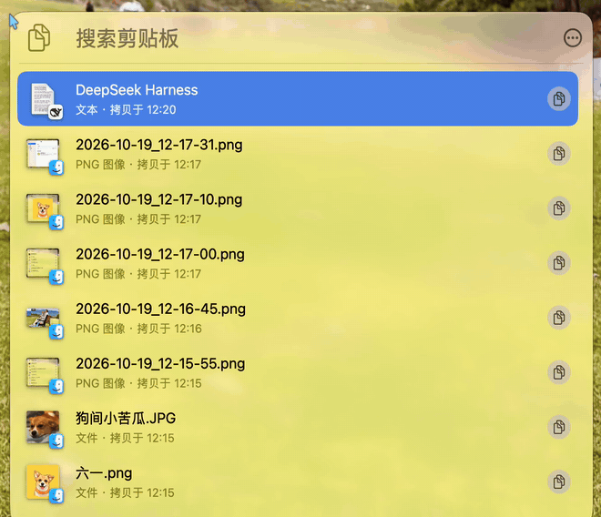
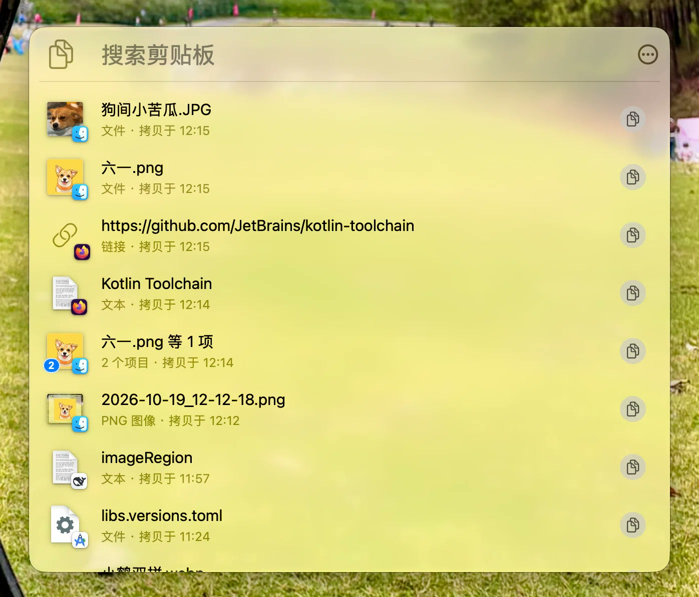
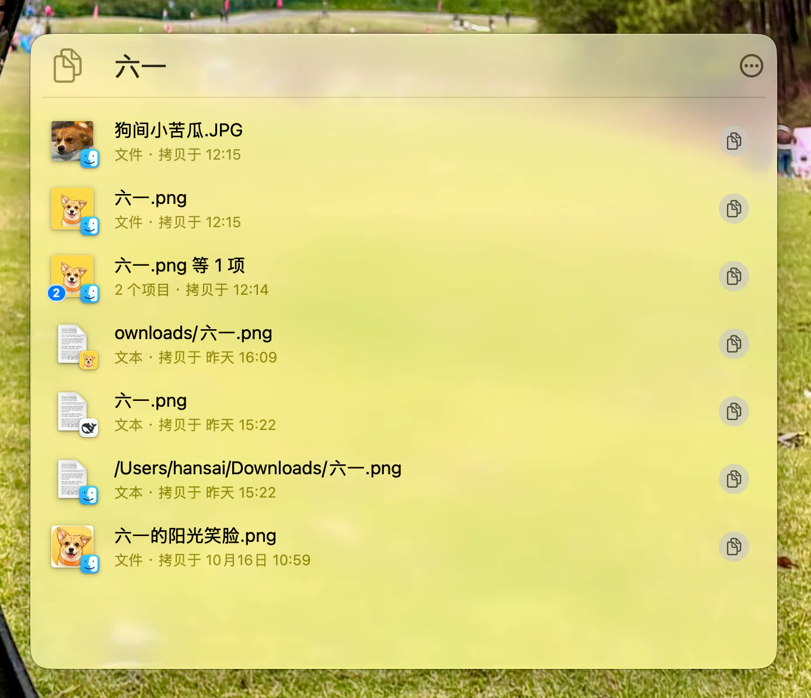
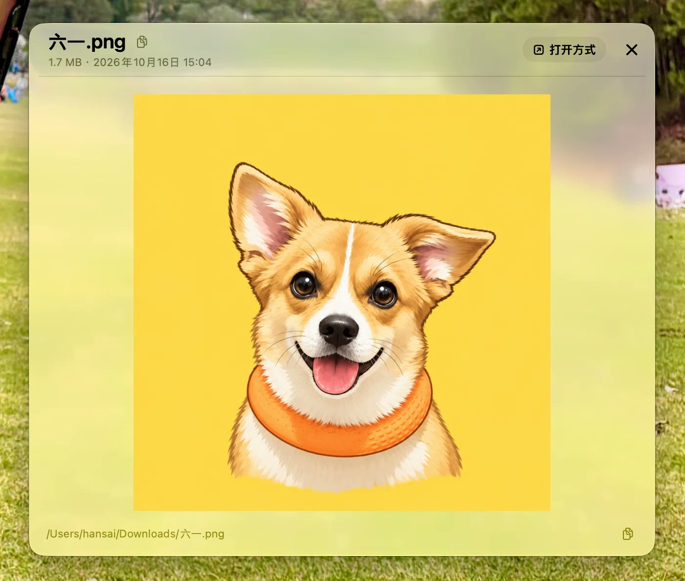
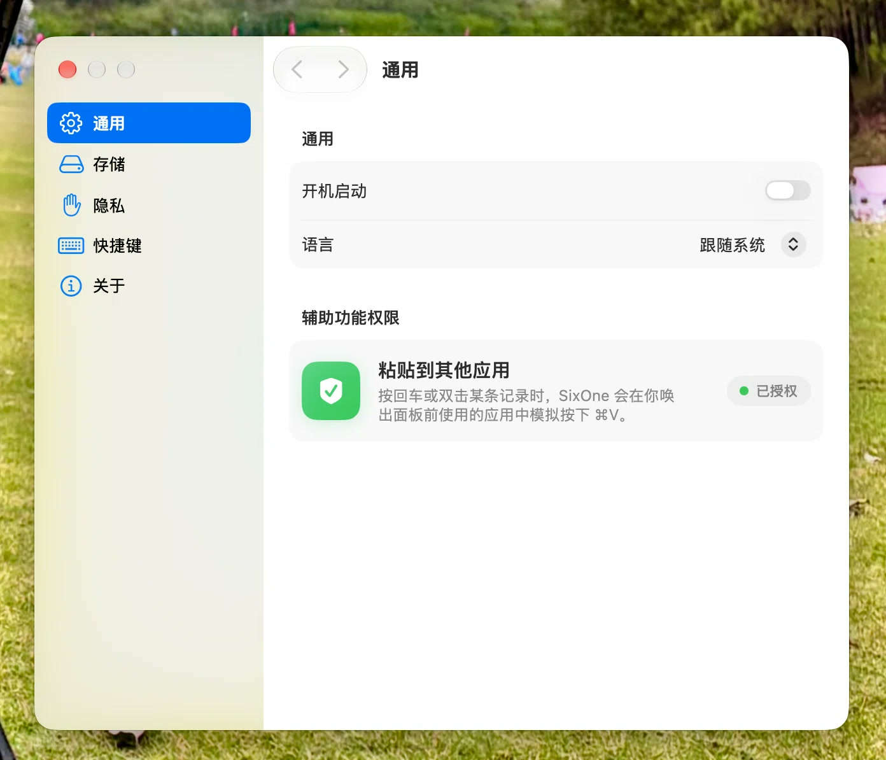

# SixOne

**简体中文 · [English](README.en.md)**

macOS 菜单栏剪贴板历史工具。按 `⌃⌘V`（默认）唤出浮层面板，浏览、搜索、预览、就地编辑并粘回历史条目。支持五类内容：**文本 / 图片 / 文件（含多文件组）/ 链接 / 颜色**。

- 菜单栏图标左键开关面板，右键打开菜单（剪贴板 / 设置… / 退出）。面板贴在唤出处：状态栏图标下方、指针处或屏幕居中。
- 原生搜索框：按正文、标题与文件路径过滤，输入经 200 ms 防抖后查询数据库。
- 预览：文本（富文本、就地编辑、`⌘F` 查找）、图片（缩放 / 平移）、文件（图片 / 视频 / 网页 / PDF / 文本 / Quick Look）、多文件列表（组内按名称 / 路径筛选）、链接、颜色。文件与磁盘图片预览底部显示来源路径，可拖选片段或一键拷贝完整路径。
- 条目动作：复制回剪贴板、粘贴进上一个应用（合成 `⌘V`）、分享、用默认应用打开 / 在访达中显示、删除、纯文本拷贝 / 粘贴（`⇧⌘C` / `⇧⌘V`）。上一个应用已退出或未回到前台时，只提示音并把内容留在剪贴板，不会粘进当前前台应用。
- 设置：忽略应用、保留时长、存储上限、全局快捷键、语言（跟随系统 / English / 简体中文）、开机自启、清空历史。语言改动重启后生效。

## 截图

一段录屏：唤出面板、打开预览、缩放图片、拷贝来源路径，再回到列表搜索：



| 面板 | 搜索 | 预览 | 设置 |
| --- | --- | --- | --- |
| <a href="docs/images/panel.jpg"></a> | <a href="docs/images/panel-search.jpg"></a> | <a href="docs/images/preview.jpg"></a> | <a href="docs/images/settings.jpg"></a> |

## 项目状态

**1.0.0，源码发布。** 不提供预编译包。库已版本化（当前 schema **V3**），由 `SixOneMigrationPlan` 打开；从 V1 升级会原地迁移，改 schema 不再需要清空历史。迁移单向：回退旧版本前先备份库文件。

**非目标：** 云同步、账号体系、多设备历史、iOS 客户端、自动更新。SixOne 只在本机、只服务单台 Mac。

## 环境要求

- **macOS 26.5 或更高，Apple 芯片。** 部署目标 26.5，文档命令指定 `arm64`。
- 验证组合：**Xcode 27.1（27A9275）+ Swift 6.4**；其他带 ≥ 26.5 SDK 的 Xcode 未经验证。
- 命令行构建不需要开发证书（`CODE_SIGNING_ALLOWED=NO`）；Xcode 构建请把 `DEVELOPMENT_TEAM` 改成自己的团队。

## 隐私与数据

完整规则见 **[PRIVACY.md](PRIVACY.md)**。要点：

- **数据只在本机。** 无遥测、账号、云同步、自动更新或第三方 SDK。库位于 `~/Library/Application Support/SixOne/SixOne.store`（签名后位于沙盒容器内）。
- **两道过滤都在读取剪贴板字节之前完成：** 密码管理器写入的「不要记录」标记，以及来源应用忽略列表（默认忽略「密码」与「钥匙串访问」）。标记判定才是关键，见 PRIVACY.md §1。
- **除容器权限与 FileVault 外不额外加密。**
- **唯一能联网的是 HTML 预览，且已围栏：** 不执行内容脚本、不允许离开本地文件，外传通道（`document`、`script`、`raw`、`popup`）全部阻断。远程图片与样式有意放行，代价是远程请求会暴露你的 IP。
- **辅助功能权限只用于一件事：** 向唤出面板前的应用合成一次 `⌘V`。

## 键盘快捷键

| 动作 | 按键 |
| --- | --- |
| 唤出 / 收起面板 | `⌃⌘V`（可在设置中修改） |
| 搜索 | `⌥⌘F`（列表内 `⌘F` 也可）；`Esc` 清空，再按离开输入框 |
| 移动选中 | `↑` / `↓`（未选中时 `↓` 落首行、`↑` 不动）；`⌘↑` / `⌘↓` 跳到窗口内最新 / 最旧 |
| 回到搜索框 | 在第一行按 `↑` |
| 粘贴进上一个应用 | `Return` 或 `⌘V` |
| 快速粘贴可见行 | 按住 `⌘` 显示编号，按 `⌘1`…`⌘9` 粘贴完整可见行（多文件组总览粘贴组内文件；外层列表加 `⇧` 为纯文本） |
| 复制回剪贴板 | `⌘C` |
| 保存编辑 | `⌘S`（仅编辑态，保存后继续编辑；`Return` 仍换行） |
| 拷贝 / 粘贴为纯文本 | `⇧⌘C` / `⇧⌘V` |
| 开关预览 | `Space` |
| 预览中切换条目 | `↑` / `↓`（多文件组只能从列表打开，切到组时停在当前条目并提示） |
| 文件组列表 | `↑` / `↓` 只在组内移动；首行 `↑` 回到筛选框，末行 `↓` 停住；`⌘↑` / `⌘↓` 跳组内首 / 末项；`Space` 预览选中文件，`Esc` 关闭组预览 |
| 组内文件预览 | `↑` / `↓` 切换文件；`⌘↑` / `⌘↓` 跳组内首 / 末项；`Space` / `Esc` / `×` 回到组列表 |
| 筛选组内文件 | 列表顶栏筛选框（`⌘F` 聚焦；`Esc` 先清空、再退出） |
| 删除选中条目 | `⌫` / `⌘⌫` / `⌦`（会先确认） |
| 打开 / 在访达中显示 | `⌘O` / `⇧⌘R` |
| 取消编辑、关预览、再收面板 | `Esc`（分层：查找栏 → 取消编辑并恢复原文 → 关闭预览 → 收起面板；有改动会先确认） |
| 循环搜索框 / 更多操作 / 列表 | `Tab` / `⇧Tab`（`Control+Tab` / `Control+Shift+Tab` 同） |
| 收面板 / 退出 / 设置 | `⌘W` / `⌘Q` / `⌘,`（编辑态先取消编辑，有改动会确认；再按一次才执行） |

面板维护自己的 Tab 循环（AppKit 控件与列表混排没有可用的系统 key view loop）：完整键盘访问开启时走「搜索框 → 更多操作 → 列表」，关闭时只走「搜索框 ↔ 列表」，与系统默认一致。主菜单不显示，只作为快捷键命令表；菜单不可用时由窗口级 fallback 按 key equivalent 找到同一菜单项、重跑校验后再发送 action。

## 快速开始

```bash
# 构建（无签名，不需要开发证书）
xcodebuild build -project SixOne.xcodeproj -scheme SixOne \
  -destination 'platform=macOS,arch=arm64' -derivedDataPath build \
  CODE_SIGNING_ALLOWED=NO CODE_SIGNING_REQUIRED=NO CODE_SIGN_IDENTITY=""

# 单元测试
xcodebuild test -project SixOne.xcodeproj -scheme SixOne \
  -destination 'platform=macOS,arch=arm64' -derivedDataPath build \
  CODE_SIGNING_ALLOWED=NO CODE_SIGNING_REQUIRED=NO CODE_SIGN_IDENTITY=""

# 运行 —— 必须在构建之后：build/ 被 gitignore，新克隆里并不存在
open build/Build/Products/Debug/SixOne.app
```

工程处于 Swift 6 语言模式（`SWIFT_DEFAULT_ACTOR_ISOLATION = MainActor`），使用了 `NSGlassEffectView` 等较新的 API。测试会真正拉起 XCTest 宿主（`TEST_HOST` 为 `SixOne.app`），需要正常的窗口会话与 pty；在容器或受限沙盒里执行 `test` 会在进程启动阶段失败，构建不受影响。

## 首次运行

**`open …` 之后看起来什么都没发生 —— 这是正常的。** SixOne 是菜单栏应用（`LSUIElement`），没有 Dock 图标也没有窗口。请看菜单栏里的剪贴板图标，或直接按 `⌃⌘V`。

第一次按 `Return`（或双击）往别的应用粘贴时，macOS 会要求**辅助功能**授权：系统设置 → 隐私与安全性 → 辅助功能 → 勾选 SixOne。未授权时面板会明确提示，不会静默失败。

上面的命令行构建产物无签名、**也不带沙盒**：`CODE_SIGNING_ALLOWED=NO` 会一并丢掉 entitlements（包括 App Sandbox），库文件落在用户级 Application Support 目录而不是容器内。需要沙盒配置请用 Xcode 构建并运行（⌘R）。

## 架构

代码按「谁依赖谁」单向分层：入口层（`SixOneApp` / `AppDelegate` / `AppComposition` / `PanelAssembly`）接起 UI（`UI/`、`Views/`），UI 之下是 Managers（`Managers/`），再往下是剪贴板与持久化层，通用件收在 `Support/`。`AppComposition` 是组合根，建出数据层、面板与全局快捷键并接线，因此可脱离 `NSApplication` 测试。

数据单向流动，只走 `ClipboardHistoryEventBus`：粘贴板变化在后台解析、去重、入库后广播，`HistoryListStore` 按发布顺序增量刷新。新增条目按 id 取单行插入窗口头部；读历史走后台 actor 上的 `ClipboardHistoryRepository`，只回传轻量 `HistoryRow`，大字段不进列表内存；写走主 context。界面动作（拷贝、粘贴、保存编辑、删除、清空）都经同一条总线回灌。

原先的巨型类型已按职责拆分：`ClipboardManager` 是捕获、历史写入、粘贴板回写、文件访问与缩略图的统一门面；`ClipboardPanelController` 把窗口生命周期、条目动作、编辑会话与按键执行分别交给 `PanelWindowLifecycle`、`PanelItemActions`、`PanelEditingSession`、`PanelKeyActionExecutor`。两个列表共用 `ListTableCoordinator` / `ListTableScaffold`，列表会话规则集中在 `HistoryListCoordinator`，视图只负责渲染与转发回调；`Preferences` 是唯一的设置 / 存储门面。

**注释刻意写得短**：只记录仍然成立的约束，不写历史。测试是可执行的契约 —— 改非显然的规则前，先读对应类型和它的测试。

## 改代码时先看这里

| 要改什么 | 落点 |
| --- | --- |
| 加 / 改一个按键分支 | `PanelKeyRouter`（窗口 pre-dispatch）+ `PanelKeyActionExecutor`；条目动作在 `PanelItemActions`，编辑与 Esc 在 `PanelEditingSession`。测试：`PanelKeyRouterTests` / `PanelWindowKeyHandlingTests` / `MenuKeyEquivalentIndexTests` |
| 加 / 改一个带菜单或快捷键的面板命令 | `PanelMenuCommand`（可用性）+ `PanelMenuCommandTable`（selector / 标题 / 键位）+ `MainMenuBuilder` 的菜单树。测试：`PanelMenuCommandTableTests` / `MainMenuBuilderTests` / `MenuKeyEquivalentIndexTests` |
| 加一条「该不该收起面板」的规则 | `PanelFocusPolicy` + `PanelFocusPolicyTests` |
| 动面板激活 / 预览捏合手势 / 状态栏点击 | 手势只投递给激活的应用，唤出时要成为 key 与 main，收起时把设置窗口摘出 key/main 候选；见 `PanelWindowLifecycle` 与 `SettingsWindowPresentationTests` |
| 改搜索词管道（防抖 / 清空 / 对齐） | `PanelSearchSession` + `PanelSearchSessionTests`；顶栏只交入「输入变了」 |
| 加一个右键菜单项 | `ItemCommand`（标题、快捷键、布局）+ `ItemCommandTests`，动作落在 `RowMenuBuilder` / `FileGroupPreview` |
| 加一个视图侧动作（复制、保存编辑、复制文字） | 经 `PanelContext.copyItem` / `copyText` / `saveEditedText` 发意图，落到 `PanelActionHandler`；不要在视图里调 `ClipboardManager` 的写方法 |
| 加一个设置项 | 在 `Preferences` 加类型化访问器，再改 `SettingsStore` 与对应面板（`Views/Settings/*SettingsView.swift`） |
| 改全局快捷键（注册 / 按键事件） | `HotKeyManager` + `HotKeyRegistering`（注册，会失败）/ `HotKeyEventMonitoring`（按键分发）+ `HotKeyManagerTests` |
| 加 / 改一个模型字段 | 从 `Persistence/Schema/SixOneSchemaV3.swift` 复制出新的 `SixOneSchemaV<N>`（不改已冻结版本），在 `SixOneMigrationPlan` 加 `MigrationStage`，再把 `ClipboardItem` 类型别名指向新版本。测试：`SchemaMigrationTests` / `SchemaIndexTests` |
| 动取数路径 | 先分清「要整条」还是「只要身份 / 路径」：`ClipboardManager.fetchFullItem` / `fetchLightItem`；列表取窗走后台 actor 上的 `ClipboardHistoryRepository.latest` |
| 改库文件位置或「打不开就改名备份、再建新库」的兜底 | `AppModelContainer` + `历史库位置与兜底` 用例。库必须保留自己的文件名，兜底只允许动 `SixOne.store` |
| 改「事后怎么找回文件」（移动 / 改名 / 重启后） | `SecurityScopedFileAccess`：bookmark 优先、原始路径兜底，一次复制最多固化 100 个 bookmark。用例：`ItemOpenabilityTests` / `PreviewLauncherTests` / `FileGroupPreviewModelTests` |
| 改预览顶栏 / 打开方式菜单 | `PreviewHeaderModel`、`PreviewHeaderView` / `PreviewGroupHeaderView`、`PreviewOpenWithMenu`、`PreviewDetailView` |
| 改预览元数据 / 副标题 | `PreviewMetadataModel`（解码、stat、文本统计）、`PreviewSubtitle`（纯格式化） |
| 改「什么算不要记录」 | `PasteboardSnapshot.doNotRecordTypes` + `ClipboardCaptureTests`；判定必须留在读内容**之前**，并与快照共用同一次 `pasteboardItems` 读取 |
| 动「粘贴进别的应用」 | `PanelPasteFlow` + `PanelPasteEnvironment`；`⌘V` 事件必须在碰剪贴板**之前**确认建得出来。测试：`PanelPasteFlowTests` |
| 动排序键 / 触碰 `recencyID` | `OrderedUUID` + `OrderedUUIDTests`；生成顺序必须与比较顺序一致 |
| 改文本文件编码判定 | `TextFileReader`（BOM → UTF-8 → GB18030 → Latin-1）+ `TextFileReaderTests` |
| 改列表选中移动 / 预览跟随 | `PanelSelectionCursor`（切预览失败要回滚）+ `PanelSelectionCursorTests` |
| 改列表会话协调（选中 / 预览关闭 / 揭示 / 复制反馈） | `HistoryListCoordinator` + `HistoryListCoordinatorTests` |
| 动列表容器 / 滚动 / 可见区 | `ListTableCoordinator` / `ListTableScaffold`；共用积木在 `ListRowPrimitives` / `HistoryListScrollGeometry` / `ListRowShell`。测试：`ClipboardVisibleRangeTests` / `HistoryListScrollTests` 等 |
| 改文件组预览（条目 / 行 / 菜单） | `FileGroupEntry`、`FileGroupRowView`、`FileGroupMenuBuilder`、`FileGroupPreview`。测试：`FileGroupMenuBuilderTests` / `GroupPreviewNavigationTests` |
| 动分享 | `PanelSharing`；面板侧只交入锚点与「收起面板」 |
| 改装配（谁接谁） | `AppComposition` / `PanelAssembly` + `AppCompositionTests` |
| 加一条本地化文案 | 代码里用 `Localizer.string(...)` / `LocalizedStringKey`，词条进 `Localizable.xcstrings`（英文为源语言，补 `zh-Hans`） |
| 改 tooltip / 悬停名称 | `.appTooltip`（`TooltipAnchor`）+ `TooltipPresenter`，测试 `TooltipPresenterTests` |
| 改行级无障碍文案 | `RowAccessibility.label` + `ListRowShell`；纯图标控件补 label / `accessibilityHidden`。测试：`RowAccessibilityTests` |
| 改短暂反馈的时长 / 取消 | `TransientFeedback`（新调度取消旧调度）+ `PanelTiming`。测试：`TransientFeedbackTests` |

## 测试

单测目标 `SixOneTests`，用 [swift-testing](https://github.com/apple/swift-testing) 编写；命令见 **快速开始**。约 626 项用例、106 个 suite，11 秒左右跑完。测试宿主与真实应用同进程（`TEST_HOST` = `SixOne.app`），`AppDelegate.isRunningUnitTests` 会切到内存库并跳过监控、快捷键与状态栏；`TestHostTests` 是哨兵。

系统资源一律用 `SixOneTests/Support/` 下的替身：`FakePasteboard`、`InMemorySettingsStorage`、`FakeHotKeyEventMonitor`、`FakeHistoryRepository`、`OffscreenHost` / `TestPanel`、`TemporaryFiles`、`Wait`。性能基准（`HistoryBenchmarkTests` / `MigrationBenchmarkTests`）只有在仓库根存在 `.benchmark-history` 或 `/tmp/sixone-benchmark` 时才跑，跑完请删掉开关文件。

## 参与贡献

欢迎贡献。构建与测试命令见 **快速开始**，「改代码时先看这里」是找文件最快的入口。

### 隐私不变量 —— 不要破坏

每条都源自一次具体故障。削弱其中任何一条，都必须写明理由并论证它依然成立。

1. **「不要记录」标记必须在读取剪贴板内容之前判定**（`PasteboardSnapshot.doNotRecordTypes`；`readRecordableSnapshot` 用同一次 `pasteboardItems` 读取完成判定与快照）。来源应用忽略列表替代不了这一道 —— 前台应用并不总是写剪贴板的那个应用。
2. **库文件保留专属文件名。** `AppModelContainer` 绝不回落到 SwiftData 默认的 `default.store`；「打不开 → 改名备份再新建」只允许动 `SixOne.store`。
3. **HTML 预览保持围栏。** 不执行内容脚本、不允许离开本地文件，外传通道保持阻断；远程图片 / 样式 / 字体有意放行 —— 改这条规则前先看 [PRIVACY.md](PRIVACY.md) §3。
4. **粘贴链路必须在改变任何东西之前失败。** 先确认 `⌘V` 事件建得出来，之后才写剪贴板、才收起面板。
5. **日志保持默认隐私级别。** 绝不把剪贴板正文或文件路径以 `privacy: .public` 插进 `os.Logger`。

### 约定

- **语言。** `README` / `PRIVACY` 以简体中文为默认（`README.md` / `PRIVACY.md`），英文版同步在 `README.en.md` / `PRIVACY.en.md`。代码注释、`@Suite` / `@Test` 显示名与提交信息用中文。
- **键盘判定保持纯函数。** `PanelKeyRouter.route(_:context:)` 与 `PanelFocusPolicy.shouldHide(_:)` 只接收快照、返回一个值，从不碰窗口。
- **新增用户可见文案**走 `Localizer.string(...)` 或 `LocalizedStringKey`，并补进 `Localizable.xcstrings` 的 `zh-Hans`。`LocalizationCoverageTests` 能抓出缺失条目。
- **测试绝不碰真实系统**，等待用 `Wait.until` 轮询而不是 `sleep`。

安全或隐私问题请走 GitHub 私下上报（**Security** → *Report a vulnerability*），不要开公开 issue。详见 [PRIVACY.md](PRIVACY.md) §7。

## 致谢

测试用 [swift-testing](https://github.com/apple/swift-testing)（Apache-2.0 with Swift Runtime Library Exception）。其余全部是 Apple 自带框架：AppKit、SwiftUI、SwiftData、WebKit、Quick Look、ServiceManagement。

## License

[MIT](LICENSE).
