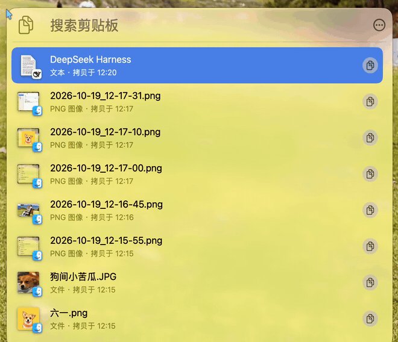
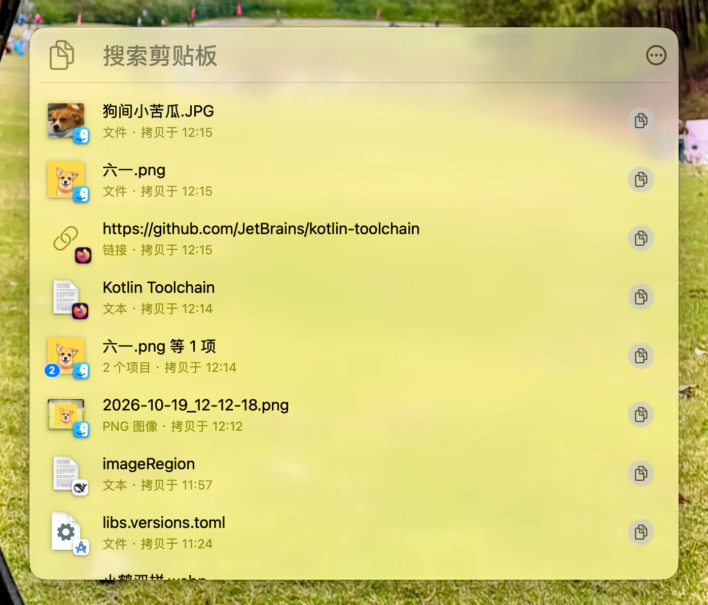
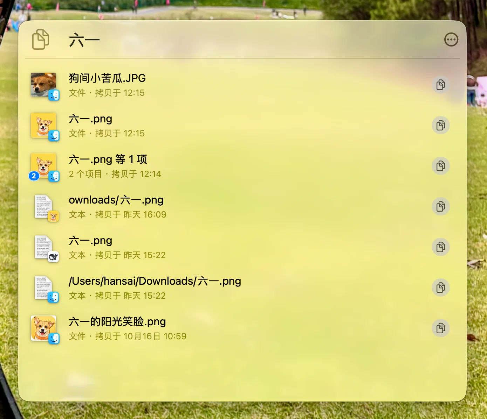
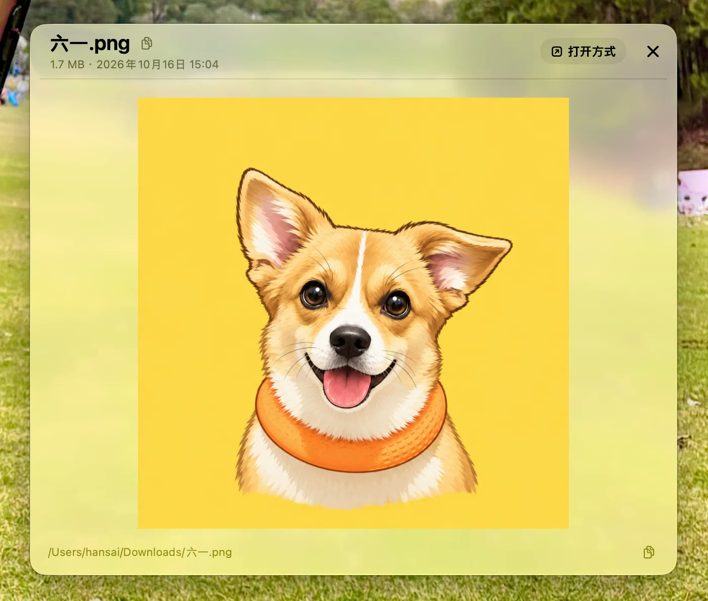
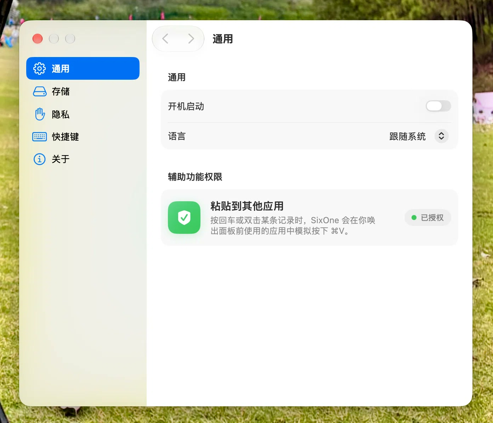

# SixOne

**简体中文 · [English](README.md)**

macOS 菜单栏剪贴板历史工具。全局快捷键（默认 `⌃⌘V`）唤出浮层面板，浏览、搜索、预览、就地编辑并粘贴回历史条目。支持五类内容：**文本 / 图片 / 文件（含多文件组）/ 链接 / 颜色**。

主要能力：

- 菜单栏图标左键开关面板，右键菜单（打开剪贴板 / 设置… / 退出 SixOne）。面板贴着唤出它的那一处出现 —— 状态栏图标下方、鼠标指针处，或屏幕居中。
- 原生搜索框：按正文、标题与文件路径过滤，输入经 200ms 防抖后走数据库查询。
- 预览：文本（富文本、可就地编辑、`⌘F` 查找）、图片（缩放 / 平移）、文件（图片 / 视频 / 网页 / PDF / 文本 / Quick Look）、多文件列表（组内按文件名 / 路径筛选）、链接、颜色。文件与磁盘图片的预览底部显示来源路径，可拖选片段或一键拷贝完整路径；文件名也可拷贝。
- 条目动作：复制回剪贴板、粘贴进上一个应用（合成 `⌘V`）、分享、用默认应用打开 / 在访达中显示、删除，以及纯文本形式的拷贝 / 粘贴（`⇧⌘C` / `⇧⌘V`）。如果上一个应用已退出或没有回到前台，SixOne 会提示音并把内容留在剪贴板，而不是粘进当前碰巧在前台的应用。
- 设置：隐私忽略应用、历史保留时长、全局快捷键、语言（跟随系统 / English / 简体中文）、开机自启、清空历史。语言改动需重启后生效。

## 截图

一段录屏：唤出面板、打开预览、缩放图片、拷贝来源路径，再回到列表搜索：



| 面板 | 搜索 | 预览 | 设置 |
| --- | --- | --- | --- |
| <a href="docs/images/panel.jpg"></a> | <a href="docs/images/panel-search.jpg"></a> | <a href="docs/images/preview.jpg"></a> | <a href="docs/images/settings.jpg"></a> |

## 项目状态

**1.0.0，源码发布。** 不提供预编译包 —— 从源码构建。库已版本化（当前 schema **V3**），通过 `SixOneMigrationPlan` 打开；从 V1 升级会原地迁移现有库，改 schema 不再需要清空历史。迁移是单向的：回退到旧版本前请先备份库文件。

**非目标：** 云同步、账号体系、多设备历史、iOS 客户端、自动更新。SixOne 有意做成只在本机、只服务单台 Mac 的工具。

## 环境要求

- **macOS 26.5 或更高，Apple 芯片。** 部署目标 26.5；文档里的构建命令指定了 `arm64`。
- **Xcode 27.1（27A9275）+ Swift 6.4** 是本项目实际验证过的组合；仍带 ≥ 26.5 SDK 的其他 Xcode 也许能构建，但未经验证。
- 命令行构建不需要开发证书（`CODE_SIGNING_ALLOWED=NO`）。Xcode 构建使用工程里记录的团队；其他贡献者请在 Signing & Capabilities 把 `DEVELOPMENT_TEAM` 改成自己的。

## 隐私与数据

剪贴板历史是 Mac 上最敏感的数据之一，完整规则见 **[PRIVACY.zh-Hans.md](PRIVACY.zh-Hans.md)**。简版：

- **所有数据只留在这台 Mac 上。** 无遥测、无账号、无云同步、无自动更新、无第三方 SDK。历史存在 `~/Library/Application Support/SixOne/SixOne.store` —— 这个路径的文件名只属于本应用；应用带 entitlements 签名时它位于沙盒容器内。
- **两道判定决定什么会被记录，且都在读取任何剪贴板字节之前完成：** 密码管理器写入的「不要记录」粘贴板标记，以及你可控的来源应用忽略列表（默认已忽略「密码」与「钥匙串访问」）。其中标记判定才是关键 —— 为什么只靠来源应用不够，见 PRIVACY.zh-Hans.md §1。
- **不额外加密落盘**，只依赖容器权限与 FileVault。
- **唯一具备联网能力的是 HTML 预览，且已被围栏**：不执行内容脚本、不允许离开本地文件的导航，能把内容带出去的远程通道（`document`、`script`、`raw`、`popup`）全部阻断。远程图片与样式**有意保留**，否则另存下来的网页会满屏裂图；残留代价是远程图片请求会暴露你的 IP —— 和任何追踪像素一样。
- **申请「辅助功能」权限只为一件事**：向唤出面板前你正在使用的那个应用合成一次 `⌘V`。本应用从不读取其它应用的界面内容。

## 键盘快捷键

| 动作 | 按键 |
| --- | --- |
| 唤出 / 收起面板 | `⌃⌘V`（可在设置中修改） |
| 搜索 | `⌥⌘F`（列表里 `⌘F` 也可）；`Esc` 先清空，再按离开输入框 |
| 移动选中 | `↑` / `↓`（未选中时 `↓` 落首行、`↑` 不动）；`⌘↑` / `⌘↓` 跳到窗口内最新 / 最旧 |
| 回到搜索框 | 在第一行按 `↑` |
| 粘贴进上一个应用 | `Return`（或 `⌘V`） |
| 快速粘贴可见行 | 按住 `⌘` 显示编号，按 `⌘1`…`⌘9` 直接粘贴完整可见行（多文件组总览粘贴组内文件；外层列表加 `⇧` 为纯文本） |
| 复制回剪贴板 | `⌘C` |
| 保存编辑 | `⌘S`（仅编辑态；保存后继续编辑；`Return` 仍是换行） |
| 拷贝 / 粘贴为纯文本 | `⇧⌘C` / `⇧⌘V` |
| 开关预览 | `Space` |
| 预览中切换条目 | `↑` / `↓`（多文件组只能从列表打开：切到组时停在当前条目并提示） |
| 文件组列表 | `↑` / `↓` 只在组内移动（未选中时 `↓` 落首行、`↑` 不动；首行再按 `↑` 回到筛选框，末行按 `↓` 停住）；`⌘↑` / `⌘↓` 跳组内首 / 末项；`Space` 预览选中文件（无选中时关闭组预览）；`Esc` 关闭组预览 |
| 组内单文件预览 | `↑` / `↓` 切上一个 / 下一个文件；`⌘↑` / `⌘↓` 跳组内首个 / 最后一个；`Space` / `Esc` / `×` 回到组列表 |
| 筛选组内文件 | 列表顶栏的筛选框（`⌘F` 聚焦；`Esc` 先清空、再退出筛选框） |
| 删除选中条目 | `⌫` / `⌘⌫` / `⌦`（会先确认） |
| 打开 / 在访达中显示 | `⌘O` / `⇧⌘R` |
| 取消编辑、关预览、再收面板 | `Esc`（分层：先关查找栏，再取消编辑并恢复原文；有改动会先确认，最后关预览） |
| 循环「搜索框 → 更多操作 → 列表」 | `Tab` / `⇧Tab`（`Control+Tab` / `Control+Shift+Tab` 也可） |
| 收面板 / 退出 / 设置 | `⌘W` / `⌘Q` / `⌘,`（编辑态的 `⌘W` / `⌘Q` 都先取消编辑，有改动会先确认；再按一次才收面板 / 退出） |

面板维护自己的 Tab 循环：AppKit 控件与列表混排时没有可用的系统 key view loop。完整键盘访问开启时按「搜索框 → 更多操作 → 列表」走，关闭时只在「搜索框 ↔ 列表」之间走，与系统默认一致；`Control+Tab` / `Control+Shift+Tab` 使用同一条循环。

主菜单在菜单栏应用里不显示，只作为快捷键命令表：`File` 提供 `⌘S` / `⌘W`，`Edit` / `Item` 提供编辑与条目命令；`About SixOne`、`Settings` 与 `Quit` 在状态栏菜单里。命令键在菜单不可用（面板是 nonactivating，菜单栏可能属于上一个应用）时，由窗口级 fallback 按 key equivalent 找到同一菜单项，重新跑一遍菜单校验后再发送 action，行为与菜单一致。

## 快速开始

```bash
# 构建（无签名，不需要开发证书）
xcodebuild build -project SixOne.xcodeproj -scheme SixOne \
  -destination 'platform=macOS,arch=arm64' -derivedDataPath build \
  CODE_SIGNING_ALLOWED=NO CODE_SIGNING_REQUIRED=NO CODE_SIGN_IDENTITY=""

# 单元测试
xcodebuild test -project SixOne.xcodeproj -scheme SixOne \
  -destination 'platform=macOS,arch=arm64' -derivedDataPath build \
  CODE_SIGNING_ALLOWED=NO CODE_SIGNING_REQUIRED=NO CODE_SIGN_IDENTITY=""

# 运行 —— 必须在构建之后：build/ 被 gitignore，新克隆里并不存在
open build/Build/Products/Debug/SixOne.app
```

工程处于 Swift 6 语言模式（`SWIFT_DEFAULT_ACTOR_ISOLATION = MainActor`），用了 `NSGlassEffectView` 等较新的 API。

测试会真正拉起 XCTest 宿主（`TEST_HOST` 是 `SixOne.app`），它需要正常的窗口会话与 pty。在容器或受限沙盒里执行 `test` 动作会在进程启动阶段失败；构建不受影响。

## 首次运行

**`open …` 之后看起来什么都没发生 —— 这是正常的。** SixOne 是菜单栏应用（`LSUIElement`），没有 Dock 图标也没有窗口。请看菜单栏里的剪贴板图标，或者直接按 `⌃⌘V`。

第一次按 `Return`（或双击）往别的应用粘贴时，macOS 会要求**辅助功能**授权：系统设置 → 隐私与安全性 → 辅助功能 → 勾选 SixOne。未授权时面板会明确提示，不会静默失败。

上面的命令行构建产物是无签名、**也不带沙盒**的：`CODE_SIGNING_ALLOWED=NO` 会一并丢掉 entitlements（包括 App Sandbox），此时库文件落在用户级 Application Support 目录而不是容器内。想要带沙盒的配置，请用 Xcode 构建并运行（⌘R）。

## 架构

代码按「谁依赖谁」单向分层，上层可以依赖下层，反向不允许。入口层（`SixOneApp` / `AppDelegate` / `AppComposition` / `PanelAssembly`）接起 UI（`UI/`、`Views/`），UI 坐在 Managers（`Managers/`）之上，再往下是剪贴板与持久化层，无业务归属的通用件收在 `Support/`。`AppComposition` 是组合根：它建出数据层、面板与全局快捷键并把它们接起来，因此可以脱离 `NSApplication` 测试。

数据单向流动、只走一条总线：`NSPasteboard` 变化在后台解析、去重、入库，然后经 `ClipboardHistoryEventBus` 广播；`HistoryListStore` 据此增量刷新。读历史走后台 actor 上的 `ClipboardHistoryRepository`，只回传轻量的 `HistoryRow` 值，大字段因此不进列表内存；写走主 context，且必须立刻对读可见。界面动作 —— 拷贝、粘贴、保存编辑、删除、清空 —— 都经同一条总线回灌，列表数据源因此不必知道是谁改的。

原先的两个巨型类型按职责拆开：`ClipboardManager` 是捕获、历史写入、粘贴板回写、文件访问与缩略图的统一门面；`ClipboardPanelController` 把窗口生命周期、条目动作、编辑会话与按键执行分别交给 `PanelWindowLifecycle`、`PanelItemActions`、`PanelEditingSession` 与 `PanelKeyActionExecutor`。两个 NSTableView 列表共用 `ListTableCoordinator` 与 `ListTableScaffold`，各自只提供行数据、行内容、选中与滚动策略。视图只发复制/保存意图，经 `PanelContext.copyItem` / `copyText` / `saveEditedText` 交给 `PanelActionHandler`；视图层把 manager 当作只读。

**注释刻意写得短**：只记录仍然成立的约束，不写历史。测试是可执行的契约 —— 下表的每一项都指向钉住它的测试 —— 改一条非显然的规则前，先读对应类型和它的测试。

## 改代码时先看这里

| 要改什么 | 落点 |
| --- | --- |
| 加 / 改一个按键分支 | `PanelKeyRouter`（窗口 pre-dispatch）+ `PanelKeyActionExecutor` 执行判定结果；条目动作在 `PanelItemActions`，编辑与 Esc 在 `PanelEditingSession`；命令键从 `MenuKeyEquivalentIndex` 取菜单项。测试：`PanelKeyRouterTests` / `PanelWindowKeyHandlingTests` / `MenuKeyEquivalentIndexTests` |
| 加一条「该不该收起面板」的规则 | `PanelFocusPolicy` + `PanelFocusPolicyTests` |
| 动面板的激活 / 图片预览的捏合手势 / 状态栏点击行为 | 手势只投递给**激活的**应用，所以唤出面板要让它成为 key 与 main，收起时要把设置窗口摘出 key/main 候选。key/main 交接规则见 `PanelWindowLifecycle` 与 `SettingsWindowPresentationTests` |
| 改搜索词管道（防抖 / 清空 / 唤出对齐） | `PanelSearchSession` + `PanelSearchSessionTests`；顶栏只把「输入变了」交进去 |
| 加一个右键菜单项 | `ItemCommand`（标题、快捷键、布局）+ `ItemCommandTests`，动作落在 `RowMenuBuilder` / `FileGroupPreview` |
| 加一个视图侧动作（复制、保存编辑、复制文字） | 经 `PanelContext.copyItem` / `copyText` / `saveEditedText` 发意图，落到 `PanelActionHandler`；不要在视图里直接调 `ClipboardManager` 的写方法。测试：`RowMenuBuilderTests` / `TextPreviewFormattingTests` / `LinkPreviewInteractionTests` |
| 加一个设置项 | `SettingsStore`（持久化口是 `SettingsStorage`）+ 对应面板的文件（`Views/Settings/*SettingsView.swift`） |
| 改全局快捷键（注册 / 按键事件） | `HotKeyManager` + 两个口：`HotKeyRegistering`（注册，会失败）/ `HotKeyEventMonitoring`（按键事件，按实例分发）+ `HotKeyManagerTests` |
| 加 / 改一个模型字段 | 从 `Persistence/Schema/SixOneSchemaV3.swift` 复制出新的 `SixOneSchemaV<N>`（不要改已冻结的版本），在 `SixOneMigrationPlan` 里加一个 `MigrationStage`，再把 `ClipboardItem` 类型别名指向新版本。形状变化和 `#Index` 会通过迁移计划落到既有库。测试：`SchemaMigrationTests` / `SchemaIndexTests` |
| 动取数路径 | 先分清「要整条」还是「只要身份/路径」：分别走 `ClipboardManager.fetchFullItem` / `ClipboardManager.fetchLightItem`；列表取窗是另一条路径，走后台 actor 上的 `ClipboardHistoryRepository.latest` |
| 改库文件位置，或「打不开就改名备份、再建新库」的兜底 | `AppModelContainer` + `历史库位置与兜底` 用例。库必须保留自己的文件名：兜底只允许动本应用自己的那个文件 |
| 改「事后怎么找回那个文件」（被移动 / 改名 / 重启后） | `SecurityScopedFileAccess`：bookmark 优先、原始路径兜底，一次复制最多固化 100 个 bookmark。用例见 `ItemOpenabilityTests` / `PreviewLauncherTests` / `FileGroupPreviewModelTests` |
| 改「什么算不要记录」 | `PasteboardSnapshot.doNotRecordTypes` + `ClipboardCaptureTests`；判定必须留在读快照**之前** |
| 动「粘贴进别的应用」 | `PanelPasteFlow` + `PanelPasteEnvironment`（事件投递、应用控制、权限、调度、时钟、提示音）。`⌘V` 事件必须在碰剪贴板**之前**就确认建得出来 —— 面板一收起，提示就没人看得见了。测试：`PanelPasteFlowTests` |
| 动排序键 / 触碰 `recencyID` | `OrderedUUID`（时间有序性）+ `OrderedUUIDTests`；排序按它倒序，生成顺序必须与比较顺序一致 |
| 改文本文件的编码判定 | `TextFileReader`（BOM → UTF-8 → GB18030 → Latin-1）+ `TextFileReaderTests` |
| 改列表选中移动 / 预览跟随 | `PanelSelectionCursor`（切预览失败要回滚）+ `PanelSelectionCursorTests` |
| 动列表容器 / 滚动手感 / 可见区 | `ListTableCoordinator` / `ListTableScaffold` 承载共用的 NSTableView 机制；`HistoryListTableView` 与 `GroupListTableView` 只提供行数据、行内容与选中。共用积木仍在 `ListRowPrimitives` / `HistoryListScrollGeometry`。测试：`ClipboardVisibleRangeTests` / `ClipboardScrollerFlashTests` / `HistoryListScrollTests` / `HistoryListRowViewReuseTests` / `GroupListTableViewTests` |
| 动分享 | `PanelSharing`；面板侧只把锚点与「收起面板」交进去 |
| 改装配（谁接谁） | `AppComposition` / `PanelAssembly`，并补一条接线用例（`AppCompositionTests`） |
| 加一条本地化文案 | 代码里用 `Localizer.string(...)` / `LocalizedStringKey`，词条进 `Localizable.xcstrings`（英文为源语言，补 `zh-Hans`） |
| 改 tooltip / 悬停名称 | `.appTooltip`（`TooltipAnchor`）+ `TooltipPresenter`；定位用例 `TooltipPresenterTests` |

## 测试

单测目标 `SixOneTests`，用 [swift-testing](https://github.com/apple/swift-testing) 编写；命令见 **快速开始**。当前 589 项用例、95 个 suite，约 11 秒跑完（swift-testing 自报的计数；`xcresulttool` 把参数化用例按 case 分别计数）。测试宿主与真实应用跑在同一进程（`TEST_HOST` = `SixOne.app`），所以 `AppDelegate.isRunningUnitTests` 会把测试进程切到内存库、并跳过监控、快捷键与状态栏；`TestHostTests` 是防止该判定失效的哨兵。

不碰系统资源的模块都靠替身驱动，替身集中在 `SixOneTests/Support/`：剪贴板走 `FakePasteboard`（因此「捕获 → 去重 → 触达置顶」可测而不会覆写你的剪贴板），设置与快捷键走 `InMemorySettingsStorage`，按键事件处理器走 `FakeHotKeyEventMonitor`，历史读取走 `FakeHistoryRepository`，离屏窗口与视图树探针走 `OffscreenHost` 与 `TestPanel`，临时文件走 `TemporaryFiles`，等待走 `Wait`。预览、定位、键盘决策、焦点策略都是纯函数或纯值输入。`HistoryBenchmarkTests` 里的性能基准只有在开关文件存在时才跑（仓库根的 `.benchmark-history`，或 `/tmp/sixone-benchmark`）；跑完别把开关文件留下，它会让全量测试变慢。

## 参与贡献

欢迎贡献。构建与测试命令见 **快速开始**，而「改代码时先看这里」表格是找文件最快的入口。

### 隐私不变量 —— 不要破坏这些

每一条都源自一次具体的故障。削弱其中任何一条的改动，都必须写明理由，并给出它依然成立的论证。

1. **「不要记录」标记的判定必须在读取剪贴板之前**（`PasteboardSnapshot.doNotRecordTypes`，在 `PasteboardAccessing.snapshot` 之前查询）。来源应用忽略列表是另一道，但它替代不了这一道 —— 前台应用并不可靠地等于写剪贴板的那个应用。
2. **库文件保留自己专属的名字。** `AppModelContainer` 绝不能回落到 SwiftData 默认的 `Application Support/default.store`，而「打不开 → 改名备份再新建」这条兜底只允许动 `SixOne.store` —— 否则它就是在操作别人的数据库。
3. **HTML 预览保持围栏状态。** 不执行内容脚本、不允许离开本地文件的导航，能把内容带出去的远程通道保持阻断（`document`、`script`、`raw`、`popup`）。远程图片 / 样式 / 字体是有意放行的 —— 改这条规则之前先看 [PRIVACY.zh-Hans.md](PRIVACY.zh-Hans.md) §3。
4. **粘贴链路必须在改变任何东西之前失败。** `PanelPasteFlow` 会先确认 `⌘V` 事件建得出来，**之后**才写剪贴板、才收起面板 —— 因为面板一收起，提示就没人看得见了。
5. **日志保持默认隐私级别。** 绝不要把剪贴板正文或文件路径以 `privacy: .public` 插进 `os.Logger`。

### 约定

- **语言。** `README` 与 `PRIVACY` 都是中英各一份；请在同一个 PR 里把 `.zh-Hans.md` 那边同步好。代码注释、`@Suite` / `@Test` 显示名与提交信息用中文。（把测试显示名翻成英文很欢迎：它不改任何逻辑，而那是外部贡献者在测试失败时要读的东西。）
- **键盘判定保持纯函数。** `PanelKeyRouter.route(_:context:)` 与 `PanelFocusPolicy.shouldHide(_:)` 只接收现场快照、返回一个值，从不碰窗口；新增分支要补对应的测试行。
- **新增用户可见文案**要走 `Localizer.string(...)` 或 `LocalizedStringKey`，**并且**进 `Localizable.xcstrings` 补上 `zh-Hans`。`LocalizationCoverageTests` 能抓出「字面量键在目录里没有条目」，但抓不出「你压根没加进去的那个键」。
- **测试绝不碰真实系统** —— `FakePasteboard`、`InMemorySettingsStorage`、`FakeHistoryRepository`、`OffscreenHost`、`TemporaryFiles` —— 等待用 `Wait.until` 轮询而不是 `sleep`。

安全或隐私问题请走 GitHub 的私下上报（**Security** 标签页 → *Report a vulnerability*），不要开公开 issue。具体说明与需要附带的信息见 [PRIVACY.zh-Hans.md](PRIVACY.zh-Hans.md) §7。

## 致谢

测试用 [swift-testing](https://github.com/apple/swift-testing)（Apache-2.0 with Swift Runtime Library Exception）编写。其余全部是 Apple 自带框架：AppKit、SwiftUI、SwiftData、WebKit、Quick Look、ServiceManagement。

## License

[MIT](LICENSE).
